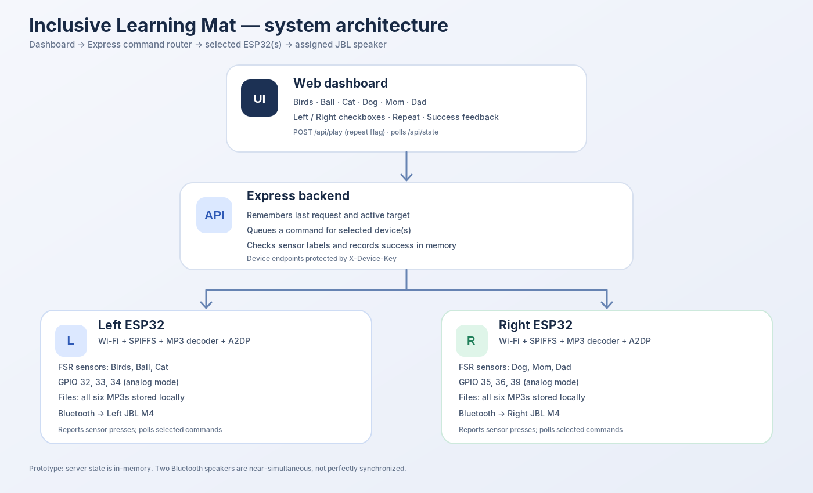
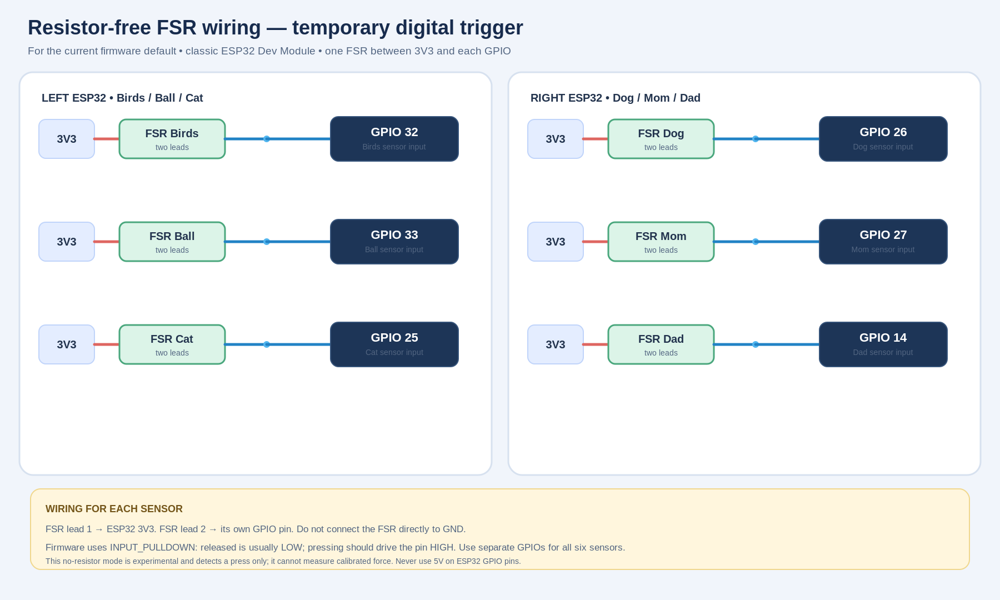
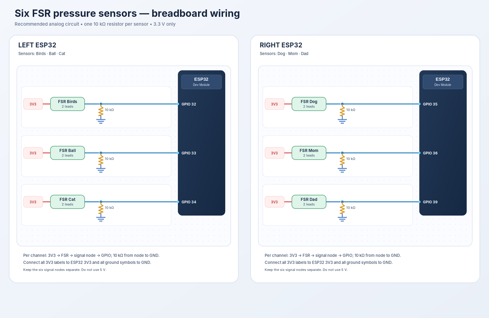

# Inclusive Learning Mat — two ESP32s, six FSRs, two JBL speakers

A starter project for a six-target learning mat. It includes an Express backend, a browser dashboard, separate Left/Right ESP32 Arduino sketches, and a wiring diagram.

## 1. Architecture



- The browser dashboard sends a label and selected speaker list to Express.
- Express remembers the current target and last play request, then queues a command only for the selected device(s).
- Each classic ESP32 polls Express over Wi-Fi. The network worker is separate from the audio loop so HTTP delays are less likely to interrupt audio decoding.
- Each ESP32 has all six WAV files in its own SPIFFS filesystem and streams the requested one to its assigned JBL speaker over Bluetooth Classic A2DP.
- The six pressure sensors are mapped as: **Left = Birds, Ball, Cat**; **Right = Dog, Mom, Dad**.
- When a sensor press is detected, the ESP32 posts the label and raw reading to Express. Express compares that label with the current target and the dashboard displays success or an incorrect response.

**Prototype timing note:** Selecting both speakers queues the same label for both ESP32s at nearly the same time. Wi-Fi polling and Bluetooth startup latency mean this is not sample-accurate synchronization; the two speakers may start a little apart.

## 2. Hardware and wiring

Use two **classic ESP32 Dev Module / ESP32-WROOM-32** boards, two JBL M4 speakers, six two-lead FSR pressure sensors, six 10 kΩ resistors (recommended), two USB data cables, and a breadboard or suitable prototype wiring.

**For your current resistor-free test wiring:**



This uses the ESP32's internal pull-down and is intended only for basic press/release experiments.

**Recommended final analog wiring (when you have a breadboard and six 10 kΩ resistors):**



### Recommended analog wiring (best for the final prototype)

Use one voltage-divider circuit per sensor:

`3V3 → FSR → signal junction → 10 kΩ resistor → GND`

Connect the signal junction to the relevant ESP32 pin. The reading normally rises when pressure rises.

| Device | FSR label | ESP32 ADC pin |
|---|---|---:|
| Left | Birds | GPIO 32 |
| Left | Ball | GPIO 33 |
| Left | Cat | GPIO 34 |
| Right | Dog | GPIO 35 |
| Right | Mom | GPIO 36 |
| Right | Dad | GPIO 39 |

These are ADC1-capable input pins on the classic ESP32, so they can be read while Wi-Fi is active. GPIO 34, 35, 36, and 39 are input-only and do not have internal pull-up/down resistors; this is why the external resistor is needed for the recommended analog circuit. Use **3.3 V**, not 5 V, on sensor circuits.

Thresholds start at `1100` in analog mode. You will need to calibrate them with Serial Monitor readings for your specific FSRs. Change `PRESS_THRESHOLD` and, if needed, `RELEASE_HYSTERESIS` in each sketch.

### Current resistor-free option (default in the firmware)

If you do not have a breadboard or resistors yet, the sketches default to:

```cpp
#define FSR_USE_EXTERNAL_RESISTORS 0
```

Connect one FSR lead to 3V3 and the other lead to its assigned GPIO (no external resistor and no direct GND connection on the sensor). The firmware uses `INPUT_PULLDOWN` for a basic digital press/release signal. Pins used in this mode are:

- Left: GPIO 32, 33, 25 → Birds, Ball, Cat
- Right: GPIO 26, 27, 14 → Dog, Mom, Dad

This resistor-free mode is only a basic digital trigger; it does not provide reliable force values. Depending on the FSR and wiring, the GPIO may not rise high enough when pressed, or the input may be noisy. If a sensor stays pressed or never triggers, switch to the recommended analog circuit with a resistor divider.

When your breadboard and six 10 kΩ resistors are ready, change `FSR_USE_EXTERNAL_RESISTORS` to `1` in **both** sketches and use the analog pin map in the table above. Do not use GPIO 34/35/36/39 for the resistor-free mode because those pins have no internal pull-up/down resistors.

## 3. Audio files on each ESP32

Both ESP32s need their own copy of all six files, because either speaker may be selected for any word. Use these exact lowercase filenames:

```text
birds.wav
ball.wav
cat.wav
dog.wav
mom.wav
dad.wav
```

Use **uncompressed PCM WAV**, 16-bit, 44.1 kHz, stereo for the initial compatibility test. This skips the memory-heavy Helix MP3 decode path that was crashing after A2DP initialization. WAV files are larger than MP3, so check that the six WAV files together fit in your selected SPIFFS partition (leave some free space; the no-OTA 2 MB app / 2 MB SPIFFS layout provides about 1.875 MiB for SPIFFS).

### Convert MP3 source clips to WAV

Use FFmpeg (or Audacity) to create PCM WAV files. With FFmpeg installed, run this in PowerShell from the folder containing the six MP3s:

```powershell
New-Item -ItemType Directory -Force .\wav-output | Out-Null
Get-ChildItem *.mp3 | ForEach-Object {
  ffmpeg -y -i $_.FullName -vn -ac 2 -ar 44100 -c:a pcm_s16le (Join-Path (Join-Path $PWD "wav-output") ($_.BaseName + ".wav"))
}
```

Copy the six generated WAVs into the uploader's `data` directory. Confirm that the total WAV size fits the SPIFFS partition before flashing.

### Uploading SPIFFS

The `.bat` uploader you used earlier reports `Data dir: ./data`, which means it is using a `data` directory relative to its own configured working folder. For each ESP32:

1. Copy the six WAV files into the uploader's **actual** `data` folder, or update the uploader config using the exact data-folder setting supported by that uploader version.
2. Close Arduino Serial Monitor / Serial Plotter to release COM port.
3. Run the SPIFFS uploader `.bat` and make sure the output lists all six expected files (not only `/test.mp3` or `/signal.txt`).
4. Wait for a successful flash/upload message.
5. Repeat for the other ESP32. Each board stores files separately.

Do **not** run the filesystem uploader and Arduino IDE Serial Monitor on the same COM port at the same time.

## 4. Libraries and board

In Arduino IDE Library Manager install:

- **Audio Tools** by Phil Schatzmann
- **ESP32-A2DP** by Phil Schatzmann
- **- **ArduinoJson** (6.x or compatible 7.x API)

Select **ESP32 Dev Module** for a classic ESP32. The Bluetooth A2DP source approach does not work on ESP32-C3/S3 boards because they do not support Bluetooth Classic A2DP. Reference: [ESP32-A2DP project and examples](https://github.com/pschatzmann/ESP32-A2DP) and [AudioTools A2DP player example](https://github.com/pschatzmann/arduino-audio-tools/tree/main/examples/examples-communication/a2dp).

## 5. Start the Express backend

Install Node.js 18 or newer. In a terminal:

```bash
cd server
npm install
npm start
```

Open `http://localhost:3000` in your browser. The health endpoint is `http://localhost:3000/health`.

The server binds to `0.0.0.0` so ESP32s on the same LAN can reach it. To discover the computer's IPv4 address on Windows, run `ipconfig` and use the Wi-Fi adapter's IPv4 address, for example `192.168.1.25`.

## 6. Configure each firmware sketch

Open `firmware/ESP32_Left/ESP32_Left.ino` and `firmware/ESP32_Right/ESP32_Right.ino` separately. In **both** files, set:

```cpp
const char* WIFI_SSID = "your-2.4-GHz-WiFi-name";
const char* WIFI_PASSWORD = "your-WiFi-password";
const char* API_BASE_URL = "http://192.168.1.25:3000"; // replace with server PC's LAN IP
const char* DEVICE_API_KEY = "local-dev-token-change-before-deployment";
```

The token must match the server's `DEVICE_API_KEY` environment variable. For a first local test, the server defaults to the same development token shown above. **Change it before deployment.**

Upload the Left sketch to the physical left ESP32 and the Right sketch to the physical right ESP32. Use Serial Monitor at 115200 baud. You should see Wi-Fi connection information, SPIFFS file checks, Bluetooth initialization, and periodic status logs.

Both ESP32s and the server computer must be able to reach each other on the same LAN. Use a 2.4 GHz Wi-Fi network for the ESP32. Allow inbound TCP port 3000 through your PC firewall for a local LAN test if Windows prompts you.

## 7. Pair each ESP32 with its own JBL M4

The firmware uses the Bluetooth name `M4` by default. If your speaker advertises `JBL M4`, change `BT_SPEAKER_NAME` in the matching sketch to the exact advertised name.

**Important if the two speakers have the same Bluetooth name:** Pair/commission the left board with only the left speaker powered on, then commission the right board with only the right speaker powered on. Test each speaker separately before enabling both. If the Bluetooth source ever connects to the wrong unit after a reboot, the two identical names are ambiguous; the robust fix is selecting each speaker by its Bluetooth MAC address (or using unique advertised names, if the model supports renaming). A name alone is not a guaranteed unique identifier.

Bluetooth speaker pairing may require the speaker to be in pairing mode. Disconnect the speaker from a phone while commissioning.

## 8. Dashboard behaviour

- Choose a sound button. The browser sends `POST /api/play` with `label` and the checked speaker side(s).
- Both speaker checkboxes may be selected. Only the selected ESP32s receive the audio command.
- **Repeat last audio** sends the same `POST /api/play` request shape again using the last label and speaker selection saved in browser and server memory, even if the checkboxes have changed since then.
- The selected audio label becomes the current expected target. When the matching physical sensor is pressed, the dashboard displays **Success!**. An unmatched press shows **Try again**.
- Success and attempts, command queues, device online state, and recent events are stored in server memory.

**Memory limitation:** Since this is a basic prototype with no database, state and queued commands reset if the Node server restarts. Add persistent storage if you need durable session history.

## 9. API overview

| Endpoint | Purpose |
|---|---|
| `GET /health` | Server health check |
| `GET /api/state` | Dashboard state, device status, recent events |
| `POST /api/play` | `{ "label": "mom", "speakers": ["left"] }` |
| `GET /api/device/:side/command` | Device-authenticated command poll; `side` is `left` or `right` |
| `POST /api/device/:side/sensor` | Device-authenticated sensor event `{ "label": "mom", "raw": 2380 }` |

Device requests must send `X-Device-Key`. Requests to `/api/play` are intentionally unauthenticated for local prototyping; add user authentication before exposing the dashboard publicly.

## 10. Deploying to Oracle Cloud later

The firmware starter is configured for **plain HTTP on a trusted local network**. Do not expose this version directly to the public internet with a device token over HTTP. For cloud deployment, put Express behind HTTPS (for example, a reverse proxy with a valid TLS certificate) and update the ESP32 firmware to validate the server's CA certificate using `WiFiClientSecure`; do not use `setInsecure()` in a real deployment. Also add authentication for the browser dashboard, rate limiting, and durable storage as needed.

## Debugging checklist

- `[FS ERROR] Missing ...`: upload all six WAV files to that board's SPIFFS.
- `[FATAL] SPIFFS mount failed`: verify the partition scheme and filesystem image.
- `[Wi-Fi WARN]`: check SSID/password, 2.4 GHz availability, and router/client isolation.
- `[HTTP ERROR] ... 401`: the device token differs from the server token.
- `[HTTP ERROR] ... connection refused`: the API base URL is wrong or the server/firewall is unavailable.
- `[SENSOR] PRESS` but dashboard does not change: check device auth and `/api/device/<side>/sensor` requests in server logs.
- Sensor always pressed/not pressed: check FSR wiring; with analog mode, verify 3V3→FSR→GPIO node and 10 kΩ from node to GND; then tune thresholds.
- No Bluetooth audio: confirm a classic ESP32 board, exact speaker name, speaker pairing mode, and the library logs. Test with only the assigned speaker powered on.


## Troubleshooting: `libhelix allocation failed` during boot

If serial output says `libhelix - allocation failed for 6944 bytes` and then the ESP32 reboots, the board is failing while initializing the MP3 decoder. It has not yet started the network-worker task, so backend commands may be queued in Express but not received by the ESP32. This does not get fixed by choosing a larger flash partition: flash partitions do not add runtime RAM.

This WAV variant uses `WAVDecoder` instead of `MP3DecoderHelix`, so it avoids the Helix decoder allocation. It also attempts to release BLE-only memory before initializing Bluetooth Classic and logs memory before/after A2DP/player setup. If A2DP still asserts after switching to WAV, capture the complete boot log: the next optimization is a callback-based A2DP source implementation.

## Low-memory HTTP polling fix (October 2026)

The current firmware parses command responses directly from `HTTPClient::getStream()` using an ArduinoJson filter for only `command.id` and `command.label`. It avoids `http.getString()` and dynamic response-body Strings, serializes sensor POSTs into fixed-size buffers, disables connection reuse, and reports heap after each request. Use the included fixed LAN URL and ensure your laptop firewall allows TCP port 3000 on the private network.


## Low-memory callback firmware (recommended test)

The latest firmware in `firmware/ESP32_Left` and `firmware/ESP32_Right` uses `BluetoothA2DPSource` with a 6 KiB PCM ring buffer instead of `AudioTools` `A2DPStream` + `AudioPlayer`. This is intended to reduce peak RAM usage. It expects PCM WAV files that are 16-bit, stereo, and 44.1 kHz. The callback is designed to output silence when idle/underflow and read buffered PCM while the loop task performs SPIFFS I/O.

Before uploading, update Wi-Fi credentials, `API_BASE_URL`, and `DEVICE_API_KEY` in both sketches. The default API URL is the local laptop address `http://10.190.101.155:3000`; update it when your laptop IP changes. This local HTTP path is for trusted LAN development, not production Internet deployment.

The two JBL speakers both advertise the name `M4`; for testing, keep the other ESP32 and other JBL turned off while a node initially connects. Auto-reconnect is temporarily disabled for stability diagnosis; after pairing is confirmed, it can be enabled with a small retry count. For reliable final operation, identify each speaker separately (e.g. by Bluetooth address or unique device name if supported by the speaker).

The firmware performs a brief startup sensor calibration. Keep the three FSRs on that board untouched during startup. With analog mode enabled, each FSR should be wired 3.3V -> FSR -> GPIO signal node -> its own 10 kΩ resistor -> GND. Each resistor must connect to the corresponding sensor's signal node, not a shared GPIO.
